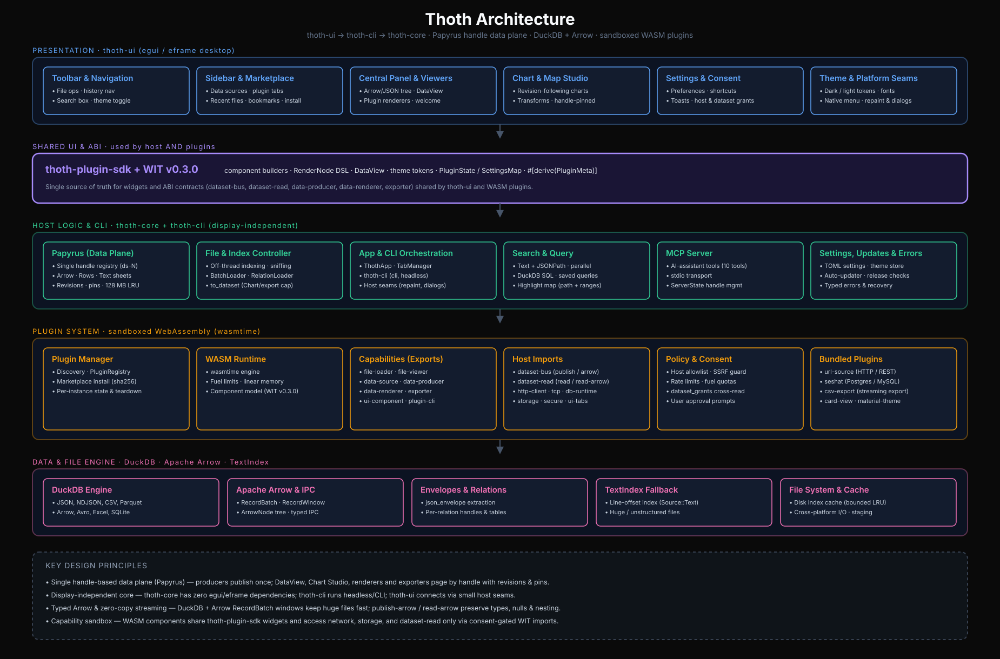

<div align="center">
  <h1>
    
    Thoth — A Fast Desktop Workspace for Your Data
  </h1>
</div>

<div align="center">

[](https://github.com/anitnilay20/thoth/actions/workflows/ci.yml)
[](https://codecov.io/gh/anitnilay20/thoth)
[](https://opensource.org/licenses/MIT)
[](https://www.rust-lang.org)

</div>

<div align="center">
  
</div>

Thoth is a high-performance, native desktop workspace for exploring your data. It opens gigabyte-sized JSON and NDJSON files by lazily parsing only what you view, and reaches beyond files through a sandboxed WebAssembly plugin system — load CSVs, call REST APIs, and browse and query PostgreSQL & MySQL databases, all in one fast app built with Rust and egui.

---

## Features

- **Massive JSON & NDJSON**: Opens gigabyte-sized JSON objects, JSON arrays, and NDJSON files with automatic format detection
- **Lazy Loading**: Only parses the parts of a file you actually view, so huge files open instantly
- **Powerful Search**: JSONPath queries and regex search across deeply nested structures, run in parallel
- **Interactive Exploration**: Expandable tree view with easy copying of paths and values
- **Database Explorer**: Connect to PostgreSQL & MySQL, browse schemas and tables, run SQL with query plans, and view results in a typed grid (via the Seshat plugin)
- **More Data Sources**: Load CSV files and call REST APIs through bundled plugins
- **WASM Plugin System**: Extend Thoth with sandboxed WebAssembly plugins — data sources, viewers, and sidebar panels authored with the `thoth-plugin-sdk`
- **MCP Server**: Expose Thoth's loaders, search, and JSONPath to AI assistants (Claude, Cursor, and more) over the Model Context Protocol
- **Themes & Custom Fonts**: Catppuccin light/dark built in, installable theme plugins, and a live system-font picker
- **Multi-Window & Tabs**: Open multiple windows and tabs to compare data across files and sources
- **Keyboard Shortcuts**: Comprehensive, fully customizable shortcuts ([see all shortcuts](docs/KEYBOARD_SHORTCUTS.md))
- **Live Settings**: Almost every setting applies instantly — no restart — and is saved to TOML

---

## Installation

### Quick Install (Terminal)

One command installs the latest release — re-run it anytime to update.

**macOS & Linux**

```bash
curl -fsSL https://raw.githubusercontent.com/anitnilay20/thoth/main/install.sh | bash
```

**Windows (PowerShell)**

```powershell
irm https://raw.githubusercontent.com/anitnilay20/thoth/main/install.ps1 | iex
```

Installs to `/Applications` (macOS), `~/.local/bin` (Linux, override with `THOTH_INSTALL_DIR`), or `%LOCALAPPDATA%\Programs\Thoth` (Windows). On macOS the build is unsigned, so the script strips the Gatekeeper quarantine for you.

### Download Pre-built Binaries

Download the latest release from [GitHub Releases](https://github.com/anitnilay20/thoth/releases).

#### macOS

**Option 1: DMG Installer (Recommended)**

1. Download the appropriate DMG:
   - **Apple Silicon (M1/M2/M3)**: `Thoth-aarch64-apple-darwin.dmg`
   - **Intel**: `Thoth-x86_64-apple-darwin.dmg`
2. Open the DMG and drag Thoth.app to Applications
3. **Important**: Open Terminal and run:
   ```bash
   xattr -cr /Applications/Thoth.app
   ```
4. Launch from Applications

**Option 2: Manual Installation**

1. Download: `thoth-aarch64-apple-darwin.tar.gz` or `thoth-x86_64-apple-darwin.tar.gz`
2. Extract: `tar -xzf thoth-*.tar.gz`
3. Remove quarantine: `xattr -cr Thoth.app`
4. Move to Applications: `mv Thoth.app /Applications/`
5. Double-click to open

> ⚠️ **Gatekeeper Warning**: This app is not code-signed. You must remove the quarantine attribute using the command above before first launch.

#### Windows

**Option 1: MSI Installer (Recommended)**

1. Download `Thoth.msi`
2. Double-click to install
3. Launch from Start Menu

**Option 2: Portable**

1. Download `thoth-x86_64-pc-windows-msvc.zip`
2. Extract and run `thoth.exe`

#### Linux

**Option 1: DEB Package (Recommended for Debian/Ubuntu)**

1. Download `thoth_*_amd64.deb`
2. Install: `sudo dpkg -i thoth_*_amd64.deb`
3. Run: `thoth`

**Option 2: Portable**

1. Download `thoth-x86_64-unknown-linux-gnu.tar.gz`
2. Extract: `tar -xzf thoth-x86_64-unknown-linux-gnu.tar.gz`
3. Make executable: `chmod +x thoth`
4. Run: `./thoth`

### Building from Source

#### Prerequisites

- Rust (latest stable version recommended)
- For building installers: [cargo-packager](https://github.com/crabnebula-dev/cargo-packager)

```bash
# Clone the repository
git clone https://github.com/anitnilay20/thoth.git
cd thoth

# Build and run in debug mode
cargo run

# Build for production
cargo build --release

# The binary will be available in target/release/thoth
```

#### Building Installers

To create platform-specific installers (MSI, DMG, DEB):

```bash
# Install cargo-packager
cargo install cargo-packager --locked

# Build installer for your platform
cargo packager --release

# Installers will be in the dist/ directory:
# - Windows: dist/*.msi
# - macOS: dist/*.dmg and dist/*.app
# - Linux: dist/*.deb
```

See [RELEASE_PROCESS.md](docs/RELEASE_PROCESS.md) for more details on the release and packaging workflow.

---

## Usage

### Opening Files

**From the Application:**

1. Launch Thoth
2. Use the top bar to open a JSON or NDJSON file (or press `Cmd/Ctrl+O`)

**From the Command Line:**

```bash
thoth document.json
thoth /path/to/data.ndjson
```

**From File Manager:**

- Double-click any `.json`, `.ndjson`, `.jsonl`, or `.geojson` file
- Right-click and select "Open With" → "Thoth"
- Set Thoth as your default JSON viewer (see [File Associations](docs/FILE_ASSOCIATIONS.md))

### Navigation and Features

3. Navigate through the file using the tree view
4. Use the search functionality to find specific values (`Cmd/Ctrl+F` to focus)
5. Toggle between dark and light mode as needed (`Cmd/Ctrl+Shift+T`)
6. Open new windows to compare multiple files (`Cmd/Ctrl+N`)

For a complete list of keyboard shortcuts, see the [Keyboard Shortcuts Guide](docs/KEYBOARD_SHORTCUTS.md).

---

## Project Structure

The host is split into three crates with a one-way dependency graph
(`thoth-ui` → `thoth-cli` → `thoth-core`):

- `thoth-core/`: Display-independent logic — file handling and lazy loading, the Papyrus data bus, the sandboxed WebAssembly plugin runtime, MCP, settings and updates. Carries no `egui`/`eframe` dependency; UI needs reach it through small seams (repaint notifications, the native file picker).
- `thoth-cli/`: The display-free command runtime and `clap` front-end (`cli`, `headless`).
- `thoth-ui/`: The `eframe`/`egui` desktop application and the `thoth` binary — all panels, Chart/Map Studio, the theme/dock rendering, and the plugin UI renderer.
- `thoth-plugin-sdk/`: Plugin authoring SDK — the shared UI component library + `RenderNode` DSL and plugin helpers (also rendered by the host)
- `thoth-plugin-sdk-macros/`: Derive macros for the SDK (`PluginMeta`)
- `plugins/`: Bundled example plugins (url-source, seshat, csv-export, card-view)
- `wit/`: WIT interface definitions for the plugin ABI
- `docs/`: Documentation for architecture and design patterns

---

## Documentation

- **[Component Architecture](docs/COMPONENT_ARCHITECTURE.md)**: Detailed guide on Thoth's component system and one-way data binding pattern
- **[Data Plane](docs/DATA_PLANE.md)**: How Papyrus owns datasets and how the grid, charts, plugins and exports read them by handle
- **[Plugin System](docs/PLUGIN_SYSTEM.md)**: Authoring WebAssembly plugins with the `thoth-plugin-sdk` (UI builders, state/settings helpers, lifecycle)
- **[Database Plugins](docs/DATABASE_PLUGINS.md)**: Building data-source plugins that talk to databases
- **[File Associations](docs/FILE_ASSOCIATIONS.md)**: How to open JSON files directly from your file manager and set Thoth as default viewer
- **[Keyboard Shortcuts](docs/KEYBOARD_SHORTCUTS.md)**: Complete reference of all keyboard shortcuts
- **[Design System](docs/DESIGN_SYSTEM.md)**: UI design guidelines and patterns
- **[Profiling](docs/PROFILING.md)**: Performance profiling and optimization techniques used in Thoth
- **[MCP Server](docs/MCP_SERVER.md)**: Use Thoth as an MCP server for AI assistants (Claude, Copilot, Cursor)

---

## Architecture

Thoth is built as a three-crate workspace (`thoth-ui` → `thoth-cli` → `thoth-core`) with a single handle-based data plane:



### Core Components

1. **Desktop UI (`thoth-ui` / `ThothApp`)**:
   - **Toolbar & Sidebar**: File opening, history navigation, search, data sources, bookmarks, and marketplace
   - **Central Panel & FileViewer**: Tree-based JSON/Arrow viewer, `DataView` / `TableView`, and plugin renderers
   - **Chart & Map Studio**: Revision-following charts and visualizations bound to Papyrus handles
   - **Theme & Settings**: Dark/light tokens, custom fonts, and live TOML-persisted preferences

2. **Papyrus Data Plane (`thoth-core/src/papyrus/`)**:
   - Single owned view of tabular data (`Source::Arrow`, `Source::Rows`, `Source::Text`) read **by handle** in pages
   - Supports monotonic revisions, consumer pinning, relation-scoped handles, and a 32-sheet / 128 MB LRU budget

3. **File Engine (`thoth-core/src/file/`)**:
   - **DuckDB + Apache Arrow**: Zero-copy windowed streaming for JSON, NDJSON, CSV, Parquet, Arrow IPC, Excel, Avro, and SQLite
   - **TextIndex Fallback**: Line-offset index for huge or unstructured files
   - **Disk Index Cache**: Bounded cache for extracted JSON envelopes and collections

4. **Search Engine**:
   - Parallel processing for fast searching across large files
   - Background scanning to maintain UI responsiveness
   - Uses Rayon for parallel iteration and memchr for optimized substring searching

5. **Plugin System (`thoth-core/src/plugin/` + WIT v0.3.0)**:
   - Plugins are sandboxed **WebAssembly components** (`file-loader`, `file-viewer`, `data-source`, `data-producer`, `data-renderer`, `exporter`, `ui-component`, `cli`)
   - Authored with **`thoth-plugin-sdk`**: type-safe builders for a serializable `RenderNode` UI tree the host renders, plus `dataset-bus` / `dataset-read` (including typed Arrow IPC) and state/settings helpers
   - The host and plugins share the *same* component types, so the SDK is one source of truth for both sides
   - See [Data Plane](docs/DATA_PLANE.md), [Plugin System](docs/PLUGIN_SYSTEM.md), and [Database Plugins](docs/DATABASE_PLUGINS.md)

### Data Flow

```text
Producer (DuckDB / TextIndex / Plugin push & pull)
  ──▶ Papyrus Registry (handles: ds-N · revision · pins · LRU)
        ──▶ Consumer (DataView / JSON Tree / Chart Studio / dataset-read renderers & exporters)
```

### Performance Optimizations

- **Lazy Parsing**: JSON is only parsed when nodes are expanded
- **Background Processing**: Long operations run in separate threads
- **Memory Efficiency**: Stores file offsets instead of keeping entire files in memory
- **LRU Caching**: Recently accessed nodes are cached for faster repeat access
- **Parallel Search**: Utilizes multiple CPU cores for searching large files

### Error Handling

- Comprehensive error handling using the `anyhow` crate
- Graceful degradation with user-friendly error messages
- Robust file type detection to prevent parsing errors

---

## Technologies

- [Rust](https://www.rust-lang.org/): Primary language
- [egui](https://github.com/emilk/egui): Immediate mode GUI library
- [serde_json](https://github.com/serde-rs/json): JSON serialization/deserialization
- [Wasmtime](https://wasmtime.dev/): Runtime for the sandboxed WebAssembly component plugins

---

## Roadmap

Key directions planned for future development:

- More database engines (ClickHouse, Redis, MongoDB, and more)
- Cross-plugin data sharing so one plugin can consume another's data
- Data visualization — charts and graphs over query and file results
- Export functionality for nodes, tables, and search results
- Diff view to compare data across files and sources
- Schema validation against JSON Schema
- In-app editing capabilities

---

## Contributing

Contributions are welcome! Please feel free to submit a Pull Request.

1. Fork the repository
2. Create your feature branch (`git checkout -b feature/amazing-feature`)
3. Commit your changes (`git commit -m 'Add some amazing feature'`)
4. Push to the branch (`git push origin feature/amazing-feature`)
5. Open a Pull Request

---

## License

This project is licensed under the MIT License - see the [LICENSE](LICENSE) file for details.

---

## Acknowledgments

- Named after Thoth, the Egyptian deity of wisdom, writing, and knowledge
- Inspired by the need for a fast, native JSON viewer for large files
